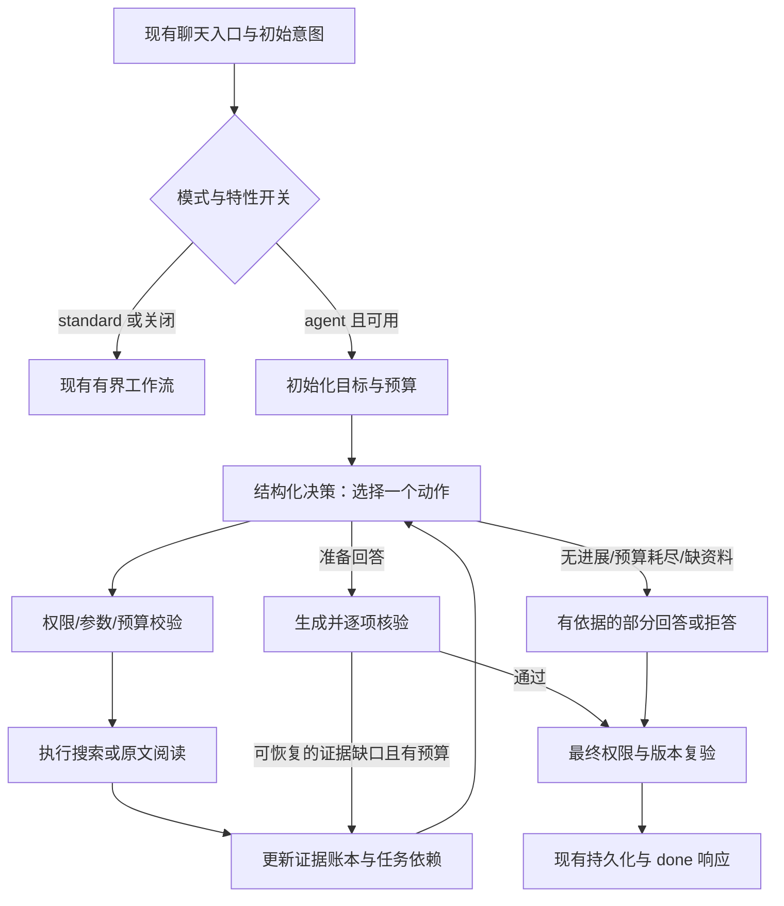

# Agentic RAG 转化实施计划

日期：2026-11-08  
状态：P0—P4 已实施并通过离线验收；P5 部分完成（离线配对评测与真实模型冒烟，真实模型配对质量评测未完成）。实施细节、实际结果和限制见[实施说明](agentic-rag-implementation.md)及第 9 节。  
执行提示词：[agentic-rag-execution-prompts.md](agentic-rag-execution-prompts.md)

## 1. 目标与完成定义

将现有“意图解析 → 独立任务检索 → 生成 → 核验/一次修订”的流程，演进为有预算上限的单 agent 检索系统：根据已取得的证据识别缺口，自主选择下一次查询或阅读动作，支持依赖前一步结果的多跳查证，并在满足证据要求或触发停止条件后结束。

首期范围：当前账户授权知识库内的只读检索与问答。保留 `mode=standard`；在特性开关控制下升级 `mode=agent`。复用现有 FastAPI、Pydantic、SQLAlchemy、检索和模型适配器，不要求引入新 agent 框架。公网搜索、任意 SQL、代码执行、外部写操作、多 agent 协作和跨请求任务自动恢复均不属于首期。

完成必须同时满足：

1. 第二次查询可由第一步实际发现的实体/引用关系产生，而非预先写死所有查询。
2. 检索结果能够改变后续动作；不同观察可以产生不同动作，也能直接停止。
3. 核验发现证据缺口时可以补检索；单纯措辞问题仍走答案修订。
4. 每个派生实体、最终事实和引用均能回溯到当前授权、有效版本的原文。
5. 超时、取消、重复动作、模型异常和预算耗尽都能有界终止。
6. 标准问答、ACL、版本隔离、幂等、会话租约和 SSE 兼容性通过回归验证。

## 2. 当前基线与复用位置

以下根据当前代码审阅记录；执行前须核对工作区实际版本，不使用旧文档中的测试数量替代当前结果。

| 文件/模块 | 当前能力 | 转化时的处理 |
| --- | --- | --- |
| `backend/app/services/intent.py` | 带出处的主题/约束状态；规则和可选模型解析；最多四项任务 | 作为初始用户目标，保留条件校验；增加独立执行状态，不用搜索结果污染用户意图 |
| `services/intent_retrieval.py` | 各任务独立 top-k；agent 模式有条件重试完整问题一次 | 保留为基线；新循环调用底层工具，不能把现有重试改名当作完成 |
| `services/retrieval.py` | hybrid/dense/bm25、重排 | 包装为受约束的搜索工具 |
| `services/corpus.py` | `CorpusScope`、活动版本/权限过滤、hydrate、同页邻块扩展 | 所有工具的唯一语料访问边界；按步骤重验授权和版本 |
| `services/answering.py` | 上下文预算、生成、引用、核验、一次修订和回退、缓存 | 提取共享生成/最终化接口，避免复制一套分叉逻辑 |
| `services/verification.py` | 引用/数字检查；可选 LLM 逐句支持性和相关性核验 | 增加可操作的结构化缺口，保留失败关闭行为 |
| `services/chat.py` | 请求幂等、会话租约、心跳、权限复验、消息持久化 | 在原入口内集成；统一总时限和租约；保存精简执行摘要 |
| `services/admission.py` / `operations.py` | 配额、并发、运行时配置覆盖 | 循环调用计量和有效配置必须贯通 |
| `services/query_evaluation.py` / `evaluation.py` | 意图策略对比、检索指标、可选 Ragas | 复用，另补多跳完成度和动作轨迹评测 |
| `services/runtime.py` / `schemas.py` | 能力声明、请求契约 | 能力状态区分 configured/available；字段向后兼容 |
| `frontend/src/api.ts` / `App.vue` | 需执行前核对的 SSE/聊天展示入口 | 兼容增量来源、草稿和最终答案替换 |

需要明确的现状：`agent_max_rewrites` 当前在新意图检索中只是是否重试的开关；`evidence.coverage` 是词项覆盖率，并非语义充分性；`citation_verifier` 默认 numeric，不代表语义核验通过。

同时参考 [architecture.md](architecture.md)、[rag-quality-iteration-plan.md](rag-quality-iteration-plan.md) 和 [ingestion-flow.md](ingestion-flow.md)。解析质量和语境增强继续沿用原路线，不把它们并入本次大规模重构。

## 3. 目标架构与状态契约



建议新增以下模块，允许在首阶段根据仓库风格调整命名，并记录原因：

| 建议文件 | 职责 |
| --- | --- |
| `services/agent_state.py` | Pydantic 状态、动作、工具结果、缺口、停止原因和预算结构 |
| `services/agent_tools.py` | 受限工具注册和调度、授权读取、参数及输出校验 |
| `services/agent_policy.py` | 结构化模型决策、模型输出校验、重试边界 |
| `services/agent_runner.py` | 有界状态机；依赖解析、循环、停止、预算和取消 |
| `services/agent_evaluation.py` | 轨迹与多跳评测，避免改变既有评测语义 |

`AgentState` 至少包含：原始问题、冻结的用户意图与约束、任务/依赖图、证据账本、缺口、执行步骤、预算消耗、语料指纹、当前状态和停止原因。单次请求内保留详细状态；持久化仅保存限长且可复查的摘要，首期不增加独立检查点表。

任务至少包含 `id`、`goal`、`depends_on`、`status`、`evidence_ids` 和可选 `bindings`。状态区分 pending/running/satisfied/blocked；校验缺失依赖、环和任务上限。初始用户目标保持不可变，动态子任务必须关联某个目标或核验缺口，不能静默增加用户没问的研究主题。

证据至少包含 `evidence_id`、`chunk_id`、`document_id`、`revision_id`、知识库 ID、页码、原文定位、原文内容或其受限引用、关联任务和取得步骤。若合并邻块，完整保存 `context_chunk_ids` 及其定位，最终复验所有实际使用的块。检索摘要、生成的语境和模型推断不能伪装成原文。

派生绑定至少包含 `value`、`evidence_ids`、原文摘录/定位和类型。绑定来自当前工具结果，不直接加入用户主题状态；须验证实体确实出现在证据中，并检查关系是否得到支持，不能仅因同段出现两个名称就认定关系成立。查询可组合原用户条件与已验证绑定。

决策输出使用判别联合 schema：`action`、`task_id`、该动作的参数、`evidence_ids`、简短可审计的 `reason_code`。拒绝未知字段、工具和 ID，不接受自由文本作为可执行动作。记录结构化动作依据，不索取或保存模型的隐式思维链。

## 4. 首期工具与证据充分性

| 工具/终止动作 | 参数与边界 | 返回结果 |
| --- | --- | --- |
| `search` | query、task_id、strategy=hybrid/dense/bm25、受限 top_k；保留所有用户约束 | 授权的候选原文、分数、版本和定位；明确空结果 |
| `read_context` | 来自已授权结果的 chunk_id、受限邻块窗口 | 当前有效版本的原文；跨页时显式列出页码；不能任意读取全库 |
| `lookup_reference` | 已有 evidence_id 和其中的原文文档名/条款引用 | 在当前 scope 中搜索关联文档；重名或引用不明确时返回 ambiguous |
| `answer` | 准备回答的任务和证据 ID | 进入共享生成及核验路径，不允许模型绕过核验直接发布 |
| `clarify` / `abstain` | 结构化原因和真正缺失的信息 | 仅在关键用户条件歧义时澄清；知识库缺资料不反复向用户追问 |

工具参数不允许模型传入用户 ID、任意知识库范围、路径、URL 或 SQL。执行器注入 `CorpusScope`。年份/部门目前缺少可靠结构化元数据，继续明确文本约束匹配的局限；首期不能承诺按发布日期或部门精确过滤，也不能拿上传时间充当生效时间。新来源读取后同样校验条件。

充分性至少按“用户目标 → 所需事实/比较维度 → 证据”映射判断。词项覆盖率仅作召回信号。比较要求两侧证据，否定结论不能从“没搜到”推出；冲突保留双方证据和适用范围，缺少可靠日期/优先级时明确无法裁定。

核验反馈至少区分：`missing_evidence`、`unsupported_claim`、`irrelevant_claim`、`numeric_mismatch`、`source_conflict`、`invalid_source`、`verifier_unavailable`。缺证据可新增检索子任务；无关内容删除；数字错误先核对原文；授权/版本失效按第 5 节终止。核验器不可用不当作普通缺口反复搜索。

新 agent 模式准备发布事实性综合答案时要求语义核验成功；numeric 模式只声明部分检查。未配置/无法调用语义核验时允许退回明确标注的原文摘录或拒答，返回降级原因，不宣称 agent 综合答案已核验。该规则不改变 standard 的既有默认配置。

## 5. 预算、兼容与不可破坏的约束

### 5.1 建议初始预算

以下是待校准的起始值，不是当前配置或性能承诺。统一放入有效配置，并覆盖环境变量、平台策略允许字段、校验、能力端点和配置示例。

| 建议配置（`RAG_` 前缀） | 初始值 | 定义 |
| --- | ---: | --- |
| `AGENT_LOOP_ENABLED` | false | 关闭时 agent 请求走原有有界流程 |
| `AGENT_MAX_STEPS` | 6 | 已接受并调度的动作次数，含 answer 动作 |
| `AGENT_MAX_TOOL_CALLS` | 8 | 所有读工具调用，嵌套搜索也计入；通常先受步骤数约束 |
| `AGENT_MAX_MODEL_CALLS` | 12 | 意图、决策、生成、核验、修订及显式重试，按实际尝试计数 |
| `AGENT_MAX_TOTAL_TOKENS` | 24000 | 总输入+输出 token；供应商缺 usage 时用保守估算并标记 estimated |
| `AGENT_DEADLINE_SECONDS` | 120 | 请求总执行时限；单次调用 timeout 不得超过剩余时限 |
| `AGENT_MAX_EVIDENCE_CHUNKS` | 24 | 账本保留的唯一原文块数；同时限制字节/token 和工具单次输出 |
| `AGENT_MAX_DYNAMIC_TASKS` | 8 | 初始任务之外的子任务上限 |
| `AGENT_MAX_RECOVERY_ROUNDS` | 1 | 生成核验后的补证据轮次，仍受总预算约束 |

动作指纹由规范化工具、查询、约束、文档版本等组成。相同动作且无新证据不重复执行；连续两次无进展停止。输出 stop_reason，至少覆盖 completed、insufficient_evidence、conflict_unresolved、budget_exhausted、deadline_exceeded、no_progress、policy_error、verifier_unavailable；取消与授权/版本变化保留现有错误语义，不能包装成成功完成。

执行每次外部调用前预留预算，超额不发起调用；生成与核验也需要预留份额。`configured_llm` 的供应商自动重试需要计入调用预算，首期可关闭隐式重试，由 runner 控制。最终生成预算不足时返回已有证据的明确摘录或拒答，不能为了“收尾”绕过上限。同步模型调用无法即时打断时不宣称已经停止底层请求；设置剩余时限，并确保取消后不再调度、不持久化成功答案。

### 5.2 配置、并发与费用

当前 `chat.run_chat` 取得 effective settings，而深层服务多次使用 `get_settings()`。实施时核实覆盖是否贯通；给新执行链显式传入同一份有效配置/运行上下文，不能让平台设置只改变表面值。长循环总时限与现有会话租约、run TTL、并发 capacity TTL、心跳协调，不能只延长模型超时。

核对 `user_daily_model_requests` 当前实际扣费粒度；为 agent 定义明确的请求级配额和模型尝试计数。所有调用经过统一计量入口，失败尝试也计数，避免一次聊天的配额覆盖无限多次模型请求。不要未经说明改变 standard 既有配额语义。

### 5.3 权限、版本、流式与缓存

- 每次工具调用前重新校验会话/用户状态和 scope 授权；读取使用当前有效条件。最终复验所有引用块，包括邻块。文档内容、工具结果中的指令不能改变工具白名单、授权、预算或用户约束。
- 每步比较语料指纹；首期采用保守方案：执行中授权撤销立即终止，语料版本变化返回可重试的冲突错误，不混合新旧证据。不能静默使用旧 ledger 作答或自动重复整个请求。
- 保持 `ChatRequest` 的 standard/agent 枚举及旧响应字段。可增添带版本的 `agent` 摘要：effective_mode、degraded_reason、status、stop_reason、steps、budget、task_summary。`task_results` 兼容原用户目标，动态子任务置于 agent 摘要中。
- 继续复用 trace/sources/draft/done/error 事件。中间来源用稳定 evidence_id，最终 citation 编号在压缩后一次确定。前端以 done 中的完整 answer/citations 替换草稿和来源，不能拼接多个修订答案或显示错号。
- 执行轨迹可持久化但限制条数和字节，默认保存 ID 与摘要，避免复制全部源文。历史查询/重放不得泄露已撤权内容；复用并扩展现有引用授权检查。
- 首期新 agent 循环绕开答案缓存读写，保留 request_id 幂等重放及其权限校验；standard 缓存行为保持现状。后续再研究缓存键中的 message_id、策略版本、有效模型/核验配置、语料和完整约束，避免把缓存改造绑进首版。
- 无 LLM、策略输出持续非法或依赖不可用时，显式降级到现有流程或安全摘录，记录原因；已经撤权、取消或版本冲突时禁止降级绕过失败。

## 6. 分阶段实施与验收

按 P0 → P1 → P2 → P3 → P4 → P5 执行。每阶段都能单独 review；状态更新到第 9 节。P0—P4 是可试用的最小闭环，P5 决定是否开放默认使用。

### P0：冻结基线与评测样例

工作：核实入口、配置传递、SSE、租约、配额和已有测试；保存当前 standard 与旧 agent 流程的行为基线；建立可离线复现的多文档 fixture 和期望证据链。建议新增 `tests/fixtures/agentic_rag/` 与评测脚本，确定基线后再改控制流。

验收：离线用例覆盖单跳、两跳、比较、无证据、冲突、追问及异常；期望来源标注到块或稳定语义定位；记录实际运行命令、依赖缺失和失败，不借用历史通过记录。输出简短架构决策，确定工具契约和兼容响应格式。

### P1：状态、预算与受限工具

工作：新增 state/tools 模块、有效运行上下文、预留/消费预算；包装现有 retrieve、hydrate 和有界上下文读取；增加来源引用查询；冻结用户约束，验证任务 DAG 和绑定出处。

验收：无需真实模型即可验证非法动作/ID/绑定、跨库读取、失效版本、超量参数、循环依赖、重复动作与输出大小边界。每个原文块均可回溯。standard 行为保持基线。

### P2：结构化决策与多跳循环

工作：新增 policy/runner；每轮将压缩状态及受限工具结果交给策略；允许按结果增加依赖子任务、选择不同搜索策略、读取上下文或停止。模型输出非法最多进行一次受预算约束的纠正，仍失败则明确降级。接入原聊天入口和特性开关，保留旧 agent 实现可回退。

验收：脚本化模型先读出“审批角色=区域负责人”，再使用该结果查询授权表，得到最终阈值；第一份文档换成不同角色时第二跳查询也变化。全量材料不允许事先塞给模型，fixture 中第二跳必要事实不能出现在第一跳结果。另有一个真实模型端到端用例验证策略实际能选择动作；无凭据时标记未验证，不虚构结果。

### P3：共享生成、核验和补证据

工作：从 answering 中提取共享生成/核验/最终化路径；核验返回可操作缺口，将缺口转为 runner 子任务；补证据次数有界。逐项判断比较两侧、条件、否定和冲突；不足时返回部分回答及缺失范围。

验收：一条用例在核验发现缺少授权条款后实际触发新检索并通过再次核验；一条不可修复用例在预算内结束并明确不足；verifier 异常失败关闭；numeric 不伪装语义核验；最终只保留实际引用来源，邻块来源全部受最终授权复验。

### P4：产品、运行保障与持久化

工作：接入 SSE 和前端阶段展示、最终替换；更新能力端点、配置示例、metadata、可观测指标和部署说明；贯通限流/配额、deadline、取消、租约与幂等；按第 5 节处理缓存。

验收：stream/non-stream 的最终答案和引用契约一致；多轮补检索不会重复显示答案或错配来源；取消后无后续调度/成功持久化；运行中撤权/切版本失败关闭；同 request_id 不重复模型执行，重放仍检查授权；关闭开关恢复原路径。前端 build 和后端回归检查通过。

### P5：配对评测与发布决策

工作：在相同语料、模型和参数下比较 standard、旧 agent、新 agent。先固定标注集再测试，开发集调参，保留独立验收集。记录质量、费用、延迟和失败分布；更新实际能力说明，不能把“支持循环”直接当成效果提升。

验收：满足第 7 节；保留复现实验报告。首期默认开关 false，可按环境启用试用；开关回退经过验证后才考虑扩大使用。若质量提升没有覆盖额外成本，保留按需 agent 模式，并记录结论。

## 7. 测试与评测门槛

### 7.1 必须通过的行为测试

| 类别 | 关键断言 |
| --- | --- |
| 单跳/提前停止 | 有足够证据时不强行多轮；最终来源正确 |
| 依赖多跳 | 第二跳实体来自第一跳，改变观察会改变动作；引用覆盖两跳关系 |
| 文档引用/邻块 | 能定位关联条款；重名歧义不乱选；上下文不越界 |
| 比较/条件/否定 | 两侧独立取证；保持年份、部门、排除条件；没搜到不等于事实不存在 |
| 缺口恢复/冲突 | 补检索确由核验反馈触发；未解决冲突明确展示范围 |
| 防注入/权限 | 文档中的“调用工具/忽略条件”等文字无控制权；不可读越权块 |
| 版本与重放 | 任一实际引用块失效均拒绝；旧请求重放不泄露撤权信息 |
| 预算/异常 | 超时、模型输出非法、供应商失败、重复工具、无 usage 均有界终止 |
| SSE/取消/并发 | 最终内容替换草稿；取消无成功结果；租约及并发控制仍有效 |
| 配置/降级 | 覆盖配置实际生效；无 LLM/核验器降级原因可见；standard 回归 |

状态机单测使用可注入的策略/工具和假时钟，验证“动作 → 观察 → 下一动作”的行为；集成测试经过实际授权入口，不能全部 mock 掉权限与数据库查询。单测通过只表示控制流正确，不代表真实模型能力已验证。

### 7.2 质量与成本评测

建议首批不少于 60 例：单跳 15、两/三跳 20、比较/约束 10、缺证据/冲突 10、追问/歧义 5；越权、版本变化、防注入等故障注入另列，不混入普通质量均分。保留开发/验收分割、随机种子和模型配置。真实模型存在波动时对核心多跳集重复至少三次，报告样本量及波动范围。

指标：任务完全回答率、完整证据链成功率、逐事实支持率、正确拒答/澄清率、约束违反率、检索调用/模型尝试/token、p50/p95 延迟、达到预算的比例。逐事实支持率需标明人工或独立评审模型及抽检方式；不以词项重叠或答案措辞相似度替代。

建议发布门槛（P0 冻结后不能为了通过随意修改）：

- 安全及兼容行为测试全部通过；越权泄露、混用失效版本、无限循环为阻断项。
- 固定多跳验收集的完整证据链成功率相比旧 agent 提升至少 15 个百分点；已接近满分时报告上限效应，由项目负责人依据原始案例决定是否接受较小增益。
- 单跳任务完全回答率下降不超过 3 个百分点；逐事实支持率不低于基线。
- 所有运行遵守硬预算；正常模型环境下预算/时限终止比例目标不高于 10%。单跳模型尝试数中位数相对旧 agent 增加不超过 2 次；多跳成本与延迟按样例报告，不用未经测量的统一毫秒指标承诺性能。
- 未执行真实模型评测时只可标注“离线控制流验证通过”，不能宣布上线验收完成。

推荐检查命令（从项目根目录执行；使用现有虚拟环境，不自动访问生产服务）：

```powershell
python -m ruff check backend scripts
Push-Location backend
python -m pytest -q
Pop-Location
Push-Location frontend
npm run build
Pop-Location
```

新增 benchmark 的命令和输入输出格式在 P0 定稿并写入报告；真实模型测试仅使用已配置的测试环境，消耗有上限，不在代码、文档或日志中写入密钥。

## 8. 交付与回退

每阶段交付：实现、必要的行为测试、配置/接口说明、变更及验证记录。不要顺带重做摄取架构、修改索引维度、增加公网工具或部署生产环境。若持久化 JSON 已能容纳摘要，不为新 agent 额外引入迁移；确需 schema 变化须写清迁移、旧数据兼容和恢复方式。

回退使用 `AGENT_LOOP_ENABLED=false`，恢复旧 agent 路径；standard 不受影响。新旧 trace/metadata 读取均兼容，停止新调度后允许已运行请求在自身时限内结束或按现有取消机制停止。不得清空数据库或重建索引实现回退。

## 9. 执行进度与交接记录

| 阶段 | 状态 | 实现/验证证据 | 下一步/阻塞 |
| --- | --- | --- | --- |
| P0 | 已完成 | 基线 `pytest` 117 通过 / 1 个环境耦合失败；修复测试 reranker provider 后全绿；新增 `backend/tests/fixtures/agentic_rag/`（7 场景：两跳、角色变体、比较、缺一侧、冲突、无证据、歧义）和离线 benchmark | 用固定验收集做真实模型配对评测 |
| P1 | 已完成 | `agent_state.py`、`agent_tools.py`；任务 DAG/绑定/预算/未知 ID/跨库/失效版本/邻块测试；standard 回归通过 | P2 接入真实策略 |
| P2 | 已完成 | `agent_policy.py`、`agent_runner.py`；特性开关接入 `mode=agent`；第一跳实体驱动第二跳、观察改变动作、重复动作/无进展/预算/时限测试；真实模型冒烟通过动作选择与语义核验 | 真实模型强制多跳与质量评测 |
| P3 | 已完成 | 共享生成/核验/最终化；结构化 `gaps`；核验缺口补检索、verifier 失败关闭、numeric 不冒充语义核验、邻块最终复验测试 | 真实模型核验缺口恢复质量 |
| P4 | 已完成 | SSE/非流式契约、`agent` 摘要、能力端点、有效配置、模型尝试计量、deadline/租约、撤销/版本冲突、幂等、缓存绕开、前端最终替换；`npm run build` 通过 | 生产试用前的容量与告警校准 |
| P5 | 部分完成 | 离线配对 benchmark：旧 agent 证据链 0.600 → 新循环 1.000，2 改善/0 回退，预算遵守 1.0；真实模型冒烟 2 例记录模型/调用/token/延迟。**真实模型配对质量评测未完成** | 固定验收集、三次重复、人工逐事实抽检 |

### 9.1 执行记录（2026-11-08）

**基线与环境**

- 初始 `python -m ruff check backend scripts`：All checks passed。
- 初始 `pytest -q`：117 passed / 1 failed。失败因开发者 `.env` 设置 `RAG_RERANKER_PROVIDER=dashscope`，而测试 fixture 清空 API key；属于测试环境耦合，不是业务代码回归。已在 `tests/conftest.py` 和 `tests/test_services.py` 固定 `RAG_RERANKER_PROVIDER=local`、`RAG_AGENT_LOOP_ENABLED=false`。
- 工作区原有未提交文档和 README 修改保留；未提交、未推送、未部署。

**新增文件**

- `backend/app/services/agent_state.py`：用户目标/任务 DAG/证据账本/绑定/缺口/动作判别联合/预算/动作校验。
- `backend/app/services/agent_tools.py`：`search`、`read_context`、`lookup_reference`，全部通过注入的 `CorpusScope` 读取。
- `backend/app/services/agent_policy.py`：结构化策略、严格 JSON 解析、一次预算内纠正。
- `backend/app/services/agent_runner.py`：有界状态机、观察更新、停止原因、核验缺口补检索。
- `backend/app/services/agent_evaluation.py`：证据链/动作/预算/延迟评分与配对比较。
- `backend/tests/fixtures/agentic_rag/`：多文档离线 fixture 和 manifest。
- `backend/tests/test_agent_state.py`、`test_agent_loop.py`、`test_agent_evaluation.py`。
- `scripts/benchmark-agentic-rag.py`、`scripts/smoke-agentic-rag.py`。
- `docs/agentic-rag-implementation.md`。

**主要修改**

- `backend/app/config.py`：新增 `AGENT_*` 预算/开关/边界配置。
- `backend/app/services/answering.py`：抽取共享生成/核验/最终化；agent 安全摘录；特性开关接入；缓存绕开。
- `backend/app/services/verification.py`：结构化 `gaps`，失败关闭，数字检查仅标记部分核验。
- `backend/app/services/chat.py`：有效配置、权限/版本探针、模型尝试计量、租约 TTL、邻块最终复验、agent 摘要持久化。
- `backend/app/services/intent.py` / `intent_retrieval.py`：显式有效配置。
- `backend/app/services/runtime.py`：区分 `agent.enabled` / `agent.available`，不再把“支持循环”写成已启用。
- `frontend/src/api.ts` / `App.vue`：`agent` 摘要与状态展示；done 最终答案替换草稿。
- `.env.example` / `.env.production.example`：新增 agent 配置示例。
- `README.md` / `docs/architecture.md`：补充新模式说明（保留原有未提交修改）。

**实际命令与结果**

```powershell
python -m ruff check backend scripts          # All checks passed
Push-Location backend; python -m pytest -q; Pop-Location   # 155 passed
Push-Location frontend; npm run build; Pop-Location        # success
python scripts/benchmark-agentic-rag.py --output docs/artifacts/agentic-rag-offline-2026-11-08.json
python scripts/smoke-agentic-rag.py --output docs/artifacts/agentic-rag-real-smoke-2026-11-08.json
```

- 离线 benchmark：7 个合成场景；旧 agent 证据链成功率 0.600，新循环 1.000；改善 2、回退 0；旧 agent p50 147.31 ms / p95 257.02 ms，新循环 p50 202.96 ms / p95 354.75 ms；平均工具调用 1.43；无模型调用。离线 fixture 延迟不作为生产性能承诺。结果见 [artifacts/agentic-rag-offline-2026-11-08.json](artifacts/agentic-rag-offline-2026-11-08.json)。
- 真实模型冒烟：`qwen3.8-flash` / OpenAI 兼容 provider / hash embedding / reranker 关闭 / `citation_verifier=llm`。两跳 fixture 完成并语义核验通过（4 次模型调用、8290 token、59.3 s）；无证据 fixture 两次搜索后拒答（2 次调用、5598 token、13.1 s）。结果见 [artifacts/agentic-rag-real-smoke-2026-11-08.json](artifacts/agentic-rag-real-smoke-2026-11-08.json)。
- 真实冒烟中第一次检索同时返回两份文档，因此该次运行没有强制第二跳；第二跳由注入策略的离线测试验证。真实模型配对质量评测未执行，不能把离线/冒烟数字当作生产质量结论。
- 真实核验器第一次冒烟出现 `verifier_unavailable`；诊断为模型 JSON 外层可能带额外文本，已改为提取首个 JSON 对象并复测通过。该修复不改变失败关闭语义。

**已知限制与设计偏离**

- 新增配置和模块按仓库风格命名，未引入新 agent 框架。
- `agent_min_search_coverage` 默认 0.25，与标准召回下限一致；提高阈值会把多子目标查询过滤为空，真实模型冒烟曾因此退回拒答。精度由策略、核验和安全摘录共同约束。
- agent 模式语义核验不可用时只发布安全摘录，`degraded_reason=semantic_verifier_unavailable`；standard 的 numeric 默认行为不变。
- 首期未做多 agent、公网搜索、外部写操作、任意代码/SQL、摄取/索引体系重构。
- 未自动部署生产、未运行破坏性迁移、未提交/推送。

**下一步**

1. 冻结独立验收集，按第 7 节完成 standard / 旧 agent / 新 agent 的真实模型配对评测（三次重复、成本、p50/p95、逐事实人工抽检）。
2. 根据真实失败样本校准 agent 搜索覆盖、预算和核验缺口策略。
3. 验证 `AGENT_LOOP_ENABLED=false` 回退和按环境试用后的容量/告警表现。
