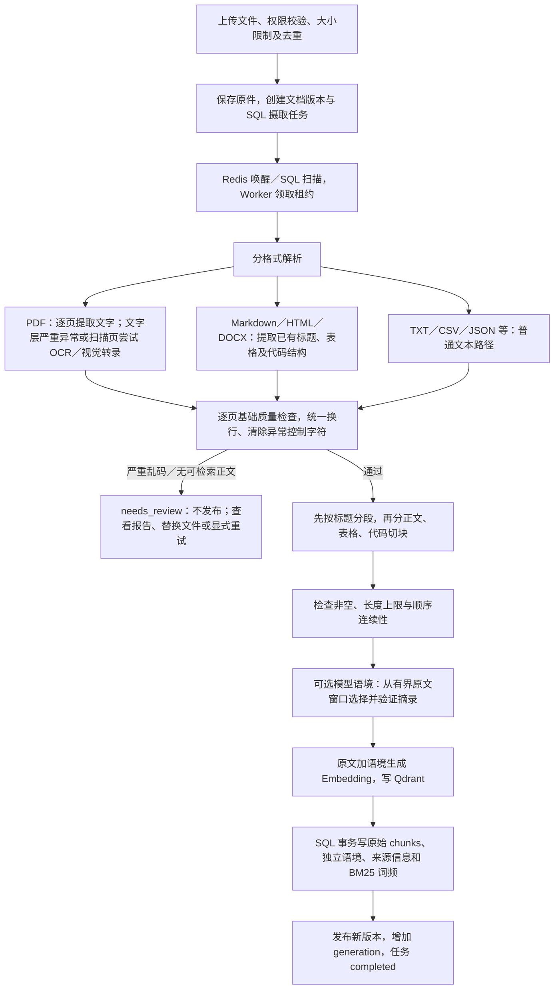

# 不规范外部文档：从解析到切片入库

本页描述当前实现。完整路线图见 [迭代方案](rag-quality-iteration-plan.md)，其中更复杂的版面恢复、人工校正编辑器、检查点恢复和缓存反馈仍属于后续设计。

## 流程



## 关键规则

### 基础质量门禁

质量检查先看清洗前的内容，避免异常控制字符被删除后掩盖乱码问题。默认替换字符比例达到 5%，或异常控制字符比例达到 2%，阻止发布；较少异常字符记录警告。单个空白页只记录警告，整篇无可检索文字则待审核。这些是可解释的初始启发式阈值，尚未由业务标注集校准，不能当作文档正确率。

PDF 文字层达到严重异常标准时尝试 OCR／视觉恢复，恢复文本替代损坏文字层；需要 OCR 但未配置、未能完成时，也进入待审核。文字层正常但图片较多时仍沿用现有扫描页触发规则，不对所有页面盲目调用模型。

自动检查不验证原文事实，不提供 OCR 置信度，也不保证检测双栏错序、缺页、复杂表格或所有乱码。文档质量需要抽样和业务评测进一步确认。

### 切块

- 普通正文：默认最大 800 字符、目标重叠 120 字符，优先段落、换行和句子分隔符，最终按字符兜底。
- 表格：尽量按行分组，每组重复表头；超长行仍需硬切。
- 代码：尽量按行拆分并保留围栏；无法容纳包装时降级处理。
- PDF 保留页码且不跨页切块；无标题文本使用递归分隔符，当前不推断主题边界。

### 语境增强：原文与派生信息分开

启用后，模型为候选片段选择主体、主题或条件相关的原文摘录；不是让模型自由编写一个无法核实的标题。

```text
原始片段：每人每天不超过500元，超出部分自行承担。
关联来源：本制度规定普通员工境内差旅的住宿报销标准。

context_summary：本制度规定普通员工境内差旅的住宿报销标准。
text：每人每天不超过500元，超出部分自行承担。
```

短文在预算内可提供全部片段；长文使用距离目标最近的片段窗口，允许包含相邻页，但不声称扫描了完整长文。输入按 UTF-8 字节保守限额，输出最多三条、每条 180 字符。程序验证来源编号及摘录是否为对应原文的连续子串；这只保证来源一致性，不保证模型选出的语境一定相关。

每个任务默认最多调用 16 次、单次超时 30 秒，不额外自动重试。预算耗尽、模型不可用、输出无效或请求失败时，保留原始片段索引。带显式 Markdown 标题或代码围栏的片段跳过模型。完整的章节提纲复用、分段模型与长期检查点尚未实现。

Embedding 输入和 SQL BM25 词频均使用“语境 + 原文”；BM25 长度统计也取同一文本。`chunks.text` 保持正文，`context_summary` 单独保存，`source_metadata` 记录片段位置、流水线版本和语境摘录来源。检索后的事实核验与引用继续使用原文，语境不自动作为回答依据。若原文缺少必要条件，保守拒答仍可能发生；本次不放宽核验规则。

### 状态和恢复

新版本不合格时，版本与任务为 `needs_review`，不会被 Worker 自动反复领取。有活动旧版的文档继续可用；首次上传的文档显示待人工审核。版本面板和任务接口提供逐页质量报告。

用户可上传清晰版本、从版本面板显式重新处理，或通过重试接口重跑；这些操作都创建新版本并再次经过质量检查，不等于人工强制放行。对被拒绝更新的文档，普通重试选择最近待审核任务的原件，避免误重跑旧活动文件。当前没有原文在线校正编辑器。

## 配置、迁移与验证

```dotenv
RAG_CONTEXT_ENRICHMENT_ENABLED=true
RAG_CONTEXT_ENRICHMENT_MAX_CALLS=16
RAG_CONTEXT_ENRICHMENT_MAX_BYTES=12000
RAG_CONTEXT_ENRICHMENT_TIMEOUT=30
```

默认关闭模型增强；启用需配置现有 LLM，且需重新索引存量文档。不要把开启模型理解为已有质量收益保证，先用同一问题集对比 Recall@K、MRR、答案支持度和成本。

新增 Alembic 迁移 `007_ingestion_quality`：为版本增加 `quality_report`，为 chunks 增加 `context_summary`、`source_metadata`。旧记录报告为空，表示未知，不能解释成已检查通过。生产先执行 `python -m app.maintenance migrate`，随后更新 API 和 Worker；配置变化需要重启相关进程。

新增测试覆盖基础质量规则、语境输入预算与来源校验、增强异常回退、待审核不写向量、替换及重试、旧版本保留、权限和增强词频一致性。模型使用测试替身，实际供应商调用、OCR 系统依赖和真实文档召回收益需要部署环境另行验证。
