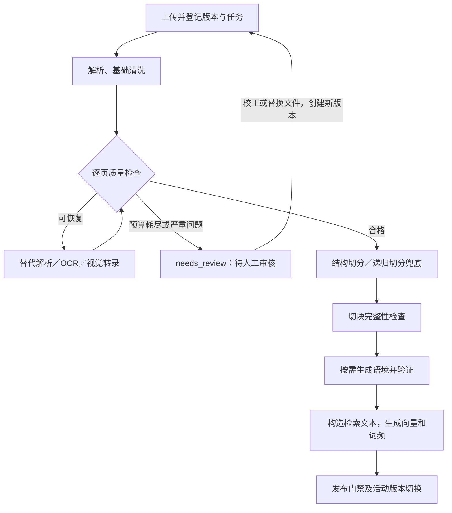

# RAG 文档质量、语境增强与缓存反馈迭代方案

日期：2026-11-01  
状态：迭代路线图。基础解析质量门禁、待审核状态及可选摘录式语境增强已落地；实际流程和实现边界见[解析到切片入库](ingestion-flow.md)。其余新增字段、接口和流程仍以设计建议为准，尤其缓存反馈闭环尚未实现。

## 1. 目标与边界

本次迭代解决两个问题：不规范外部文档在解析、切块后丢失信息或语境；用户指出答案不好后，系统缺少主动纠错和阻止旧答案复用的闭环。

实施顺序为：建立评测基线 → 文档质量检查与隔离 → 语境增强切块 → 反馈与缓存失效 → 按需增强版面解析和主题分段。文档处理与缓存反馈可以独立发布，最终统一验收。

首期不追求自动修复所有文档，不让模型重写原文，不默认将整篇长文发送给模型，不将主观差评直接升级为所有用户的全局失效。

## 2. 当前实现核对

| 环节 | 已有能力 | 缺口或边界 |
| --- | --- | --- |
| 解析 | 分格式解析；PDF 逐页提取文字，在特定条件下使用 OCR／视觉转录 | 缺少系统性的版面恢复、质量记录和隔离；OCR 尚未完整采集词级置信度 |
| 切块 | 标题分段；正文递归切分，默认 800 字符、目标重叠 120 字符；表格按行分组并重复表头；代码尽量按行拆分 | 没有模型语境补充；PDF 不恢复完整章节／表格结构；没有持久化父子块索引 |
| 来源 | chunks 保存正文、页码、顺序和版本关联 | 需要补充解析来源、质量问题、原文位置与增强信息 |
| 任务 | SQL 持久化、租约、心跳、退避重试；Redis 唤醒 | 缺少待人工审核流程及处理检查点 |
| 发布 | 向量写入后，在 SQL 事务中提交块和词频、切换活动版本、增加知识库 generation；失败保留旧版本 | 质量门禁需要接入发布条件 |
| 检索 | Dense + SQL BM25、候选有效性验证、精排；特定条件下同页邻块扩展 | 增强文本与可引用原文需要分离 |
| 缓存 | verification.passed 时尝试写入，TTL 可禁用；键包含语料和配置等信息 | 没有负反馈失效与重新生成协议；当前核验条件不足以表示用户满意 |

缓存另有一个需先验证的问题：当前真实聊天将每轮新建的 message_id 纳入缓存键，跨请求相同问题可能无法复用答案。实施缓存改造前应测量实际命中行为，而不能假设相同问题必然命中。

## 3. 目标流程



## 4. 文档质量检测和降级

### 4.1 检测位置与规则

解析后以页／区域为单位检测，切块后以片段为单位检测。规则首先返回具体问题、严重程度与动作，不以单一总分决定所有文档的命运。

| 检查 | 信号 | 动作 |
| --- | --- | --- |
| 内容缺失 | 有明显文字区域但有效文字很少、解析页数与源文件不符 | 重解析；确认缺失后阻止发布 |
| 乱码 | 替换字符、异常控制字符、异常符号比例 | 结合代码／公式类型判断，尝试编码或替代解析 |
| OCR 疑点 | 低置信度词及其位置；重点关注金额、单位、否定词 | 重识别或人工确认；未提供置信度时记录 unknown |
| 重复噪声 | 多页相近位置重复的文本 | 标记候选页眉页脚，保守清理并保存变换记录 |
| 阅读顺序 | 栏布局、文本框顺序冲突 | 使用带坐标的解析器；无法检测时不宣称质量通过 |
| 块完整性 | 空块、超长、异常碎片、内容覆盖、重复、表头和代码围栏 | 重切分或隔离；重叠正文、重复表头纳入覆盖校验规则 |

检测通过仅表示未发现明显解析风险，不表示内容事实正确。阈值通过标注文档校准，普通正文、公式、代码和表格分别配置；首期对缺乏依据的规则先观察，再启用拦截。

### 4.2 有界降级

默认解析 → 替代解析／版面解析（按格式支持）→ OCR／视觉转录 → 人工审核。按问题页降级，不默认重跑全篇。设置每页最大尝试次数、任务总时长、输入页数及模型调用预算，每次尝试保存结果。OCR 不适用于修复所有阅读顺序问题，应按失败原因选择路径。

网络超时、供应商暂时不可用等进入现有退避重试；文件严重模糊、缺页等质量问题进入 needs_review，避免无限自动重试。

### 4.3 发布与人工审核

首期采用整版本门禁：任一关键页存在阻断问题，新版本不发布。旧活动版本继续服务；首次上传则不可检索。局部发布放到后续迭代，需明确展示缺页范围，并单独处理跨页条款风险。

界面展示问题页、原因和建议操作，支持查看原件、替换清晰文件、提交校正内容、重新处理。校正和替换创建新版本，保留审核人及审计记录。首期不允许无记录地强制忽略阻断问题；确需人工放行时另行定义角色和审计规则。

## 5. 语境增强切块

### 5.1 主方案：先切块，再补语境

保持现有结构切分和长度兜底。对缺少标题、主体或适用条件的块，模型结合原文上下文生成简短语境，默认目标 50～150 个中文字符，实际输入和输出仍以 token 预算约束。

```text
原始块：每人每天不超过 500 元，超出部分自行承担。
补充语境：本片段说明公司境内差旅中普通员工的住宿报销上限。

检索文本 = 补充语境 + 原始块
可引用证据 = 原始块及可追溯的原文上下文
```

短文在预算内可使用全文；长文先建立带来源段落 ID 的提纲，每个块只输入提纲、所属章节与有限邻居。提纲属于派生信息，不能代替原文证据。优先复用同版本上下文，批量处理并限制并发。

### 5.2 输出与安全约束

模型输出结构化字段：display_title、context_summary、supporting_block_ids。标题标明为自动生成，不能伪装成原文标题。

模型只能补充原文明确支持的主体、主题、适用范围；无法确定时输出空语境。所有引用 ID 必须属于当前文档版本和输入范围。数字、日期、主体等新增内容做一致性检查；无法确认的增强结果弃用，回退到原始块。

外部文档按不可信数据处理，其中的指令不参与系统控制；语境生成过程不开放外部工具。敏感文档继承原有权限和模型调用配置。

### 5.3 检索与引用分离

Embedding 与 BM25 可使用增强文本；SQL 的 chunks.text 保持原文。BM25 词频和 token_count 必须基于同一份检索文本构建，避免长度归一化不一致。

检索返回两类字段：用于匹配的增强信息和用于核验的原文证据。精排可显式输入二者，但事实核验、引用展示与答案依据只使用原文；如果结论需要增强语境指向的来源段落，必须实际读取、核验并纳入引用预算。

语境增强不能修复 OCR 错字。增强服务不可用时，质量合格的文档可降级为原文索引，并记录增强状态，不应无限阻塞摄取。

### 5.4 后续选项：模型辅助主题分段

仅当评测证实必要时加入。模型输出主题边界对应的原文段落 ID，由程序重新组合原文，并校验顺序、完整覆盖、无丢失及长度上限。不要让模型重写全文来完成分段。此功能与语境增强分别开关、分别评测。

## 6. 数据结构调整建议

以下为建议迁移，不直接改变现有主键和引用标识。

| 表 | 建议新增或调整 |
| --- | --- |
| document_revisions | quality_status、quality_report JSON、parser_version、splitter_version、enrichment_version、artifact_manifest（解析与检查点文件引用及校验值） |
| ingestion_jobs | status 增加 needs_review；复用 stage 展示阶段；增加 pipeline_version 和检查点引用，支持有界恢复 |
| document_quality_issues（新增） | id、revision_id、page／区域定位、code、severity、metrics JSON、resolution、resolved_by、resolved_at |
| chunks | context_summary、display_title、source_locator JSON、quality_flags JSON；text 保持原文 |
| answer_feedback（新增） | id、user_id、message_id、reason、comment、scope、answer_version、created_at；按业务约束防重复提交 |
| answer_cache_entries（新增） | cache_key、scope_key 联合主键、epoch、invalidated_at、reason；作为持久失效依据 |
| messages.run_metadata | 增加 cache_key、cache_scope、cache_epoch、answer_version、缓存准入结果；不要把同名动态字段误认为已有列 |

解析产物和逐页检查点保存在共享文件目录，SQL 保存定位和校验信息；继承文档权限、保留期、删除清理与备份策略，不允许通过任意路径访问。新增质量问题表随版本清理；反馈表不复制整段敏感正文。

## 7. 缓存质量与用户反馈闭环

### 7.1 缓存准入和键设计

收紧准入：正常完成、证据充分、无澄清需求、核验通过、来源有效才允许进入答案缓存。拒答与失败结果首期不进入答案缓存。TTL 是存活上限，不代替质量控制。

将随机 message_id 从内容缓存键中移除，保留确定性的意图状态、问题、知识库授权范围、语料代次、模型／Embedding／精排／提示词／流水线版本等。首期使用用户级作用域，不跨用户共享答案，减少权限和偏好混用风险。

拆开可复用内容和本轮元信息：缓存不保存本轮消息 ID、意图来源 ID 等请求专属标识；命中时使用当前请求重新组装这些字段。即使命中仍核查授权、活动版本、有效期和失效 epoch。

### 7.2 反馈与重新生成

建议接口：POST /api/messages/{id}/feedback；POST /api/messages/{id}/regenerate。均检查消息归属与引用访问权。

负反馈先持久化，事务内增加对应作用域的 cache epoch，再清理 Redis／本地副本。重新生成必须使用新 request_id 并绕过答案缓存；相同 request_id 的幂等回放仍保持原语义，不偷偷执行第二次生成。

个人风格问题仅对该用户失效，并将新的表达偏好纳入请求上下文；确认事实错误后再由有权限的审核流程扩大失效范围。根据反馈原因选择重检索、重新生成或提示更新原文，不能承诺删除缓存即可改善答案。

### 7.3 防止并发旧结果回填

生成开始读取 epoch；结束时通过 SQL 条件校验确认 epoch 未变，再授权该结果写缓存。缓存条目携带 epoch，读取时与 SQL 失效记录比对；即使旧任务在失效后写入，也不能被复用。Redis 仅作为加速层，失效正确性不依赖它可用。

反馈发生在生成授权与 Redis 写入之间的竞争，由读取校验兜底。已经发出的流式内容无法撤回，最终结果提交前也应检查 epoch；失效后将该运行标为已过期并引导重试。多 API 实例的本地缓存同样执行 epoch 校验。首期接受额外 SQL 读取成本，后续优化不得牺牲失效语义。

## 8. Worker 协调及改动位置

沿用 SQL 为事实来源、Redis 唤醒的模式，不引入新的通用任务中间件。Worker 顺序执行解析、质量检查、切块、增强、索引与发布；耗时操作不持有长 SQL 写锁，使用现有租约心跳，检查点和最终写入均校验 lease_token。

检查点按 revision_id + pipeline_version + 阶段标识，模型结果额外绑定原文哈希与模型／提示词版本。中途崩溃恢复时复用兼容检查点；不同版本不复用。质量隔离在向量写入前完成；失败和租约丢失时沿用清理任务回收未发布索引。

| 文件／模块 | 主要改动 |
| --- | --- |
| backend/app/services/parsing.py、structured_parsers.py | 解析产物、位置、质量信号与降级路径 |
| backend/app/services/document_structure.py、splitting.py | 来源定位、切块检查、可选主题边界 |
| 新增 quality.py、context_enrichment.py | 质量规则、语境生成与验证 |
| backend/app/worker.py | 阶段、检查点、needs_review、发布门禁 |
| backend/app/models.py、迁移目录 | 新增字段、表、索引和兼容迁移 |
| backend/app/services/corpus.py、retrieval.py | 增强检索文本、BM25 一致性、原文引用分离 |
| backend/app/services/answering.py、chat.py | 准入、缓存键、epoch、重新生成和元信息重建 |
| backend/app/api、frontend | 审核、反馈及重新生成入口 |

## 9. 分阶段交付与验收

### P0：基线与口径

整理匿名或授权的测试集，覆盖无标题、多主题长段、扫描件、双栏、表格、跨页条款、乱码及重复页眉；标注问题、正确来源和答案条件。记录现有解析成功率、Recall@K、MRR、无关上下文占比、答案支持度、时延、模型成本及实际缓存命中率。

同时记录当前策略、模型和提示词版本。800／120 是现有默认配置，不作为无需实验的最佳值。

### P1：质量检测与审核门禁

交付逐页问题记录、基础降级、needs_review 界面和新版本门禁。

验收：严重缺失不得自动发布；质量问题不能进入无限重试；旧版持续可检索；原件、问题位置、处理动作可追溯；空白封面和公式页不因单一字符规则被错误阻断。以标注集统计误拦截和漏检，达成业务确认的阈值再启用硬拦截。

### P2：语境增强与索引重建

交付独立语境字段、增强检索文本、来源支持校验、成本上限及降级开关。存量文档通过新版本重建索引，不能只改 SQL 而保留不一致的向量／词频。

验收：增强失败仍可按策略使用合格原文；增强内容不冒充原文；不新增无依据数字或条件；在同一测试集对比基线、语境增强、不同大小策略，检索和最终答案收益达到预先约定门槛且成本可接受。无收益的文档类型默认关闭增强。

### P3：反馈、缓存失效与重新生成

交付缓存键修正、准入、反馈接口、epoch 和重新生成流程。

验收：反馈提交后发起的新请求不返回被失效版本；并发旧任务回填不能恢复旧缓存；多实例本地缓存及 Redis 故障场景保持一致语义；重新生成使用新请求 ID；相同请求 ID 保持幂等；权限撤销和文档更新后旧结果不可越权回放；缓存命中不携带上一轮的消息标识。

### P4：依据数据扩展

针对仍表现差的文档加入版面恢复、跨页结构关联和模型辅助主题分段，逐项消融评测；父子块索引、局部发布与跨用户共享缓存另行设计，不捆绑首期交付。

## 10. 发布、监控和回滚

按知识库逐步启用质量门禁、语境增强及新缓存逻辑。监控解析降级率、待审核率、质量误报、增强失败率、每页／块成本、摄取时长、检索指标、反馈率、缓存命中与失效拦截次数。

数据库采用兼容的增量迁移；旧数据质量标记为 unknown，不自动标为合格。策略版本变化触发受控重建和缓存命名空间更新。发布前验证旧原件和版本元数据可用于重新索引；不能假设旧向量和块仍存在。回滚时关闭增强或恢复原切块策略并重建所需索引，按现有原子发布机制切换；新缓存命名空间可整体停用。质量隔离记录和反馈保留用于追溯。

完成设计评审后，按 P0→P1→P2 的顺序推进文档链路；P3 可独立实施。上线阈值、审核责任人和模型成本预算需在基线结果出来后确定，不预先承诺未经验证的提升比例。
